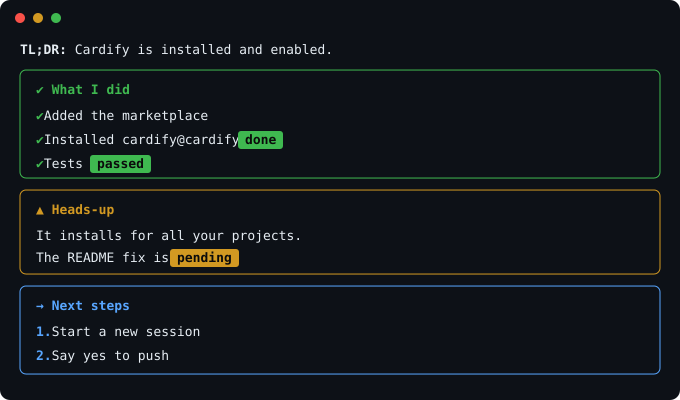

# Cardify

Turn Claude's answers into real UI: cards, tables, charts, stat tiles, buttons and inputs.

Cardify is a [Claude Code](https://claude.com/claude-code) plugin. Cardify works like [OpenUI](https://github.com/thesysdev/openui): instead of guessing structure from markdown, it teaches Claude a small `ui` block language and draws what Claude writes as real components.



*Illustrative mockup of the card styles.*

## How it works

1. Cardify adds a short section to Claude's system prompt (only in sessions that draw a screen).
2. For answers with structure, Claude writes a fenced `ui` block. Prose around it stays normal markdown.
3. Cardify draws the block as components, inline in the chat and in the `/cardify` pane.
4. Replies with no `ui` block still get a best-effort card layout from their markdown.

```ui
title: 🍎 Stock snapshot
callout warn: ⚠️ Not live data | Background only, not advice.
stats:
- Tickers | 3
table: Ticker | Company | Note
- AAPL | Apple | Services keep growing
bars: Revenue growth
- Apple | 8 | 8%
- Microsoft | 16 | 16%
buttons: Next steps
- Get live prices | Search the web for current prices
ask: Which stock first?
```

| Component | Draws |
|---|---|
| `title: text` | heading |
| `callout ok\|warn\|bad\|info\|next: Title \| Body` | colored card with a sticker |
| `stats:` rows `- Label \| Value \| note` | stat tiles, note green for `+`, red for `-` |
| `table: A \| B` rows `- a \| b` | striped table with real columns |
| `cards: Title` rows `- Name \| subtitle \| body \| tone` | grid of tinted mini cards |
| `kv: Title` rows `- Key \| Value` | fact sheet |
| `bars: Title` rows `- Label \| number \| text` | bar chart |
| `progress: Title` rows `- Label \| percent` | progress meters |
| `timeline: Title` rows `- When \| What` | timeline |
| `list:` / `steps:` rows `- item` | bullets / numbered steps |
| `buttons:` rows `- Label \| prompt` | buttons that send the prompt to Claude |
| `ask: Question` | text box that sends your answer to Claude |
| `badges:` rows `- text \| tone` | sticker badges |
| `[ok: Public]` inside any cell or item | a soft colored pill |

Cards are dark tinted panels with their own text colors, so they read the same on light and dark themes. An ask or a button sends once; the card then shows what it sent.

The system prompt is fixed when a thread starts, so start a new session after installing or updating. `/cardify off` shows `ui` blocks as plain markdown instead.

## Markdown fallback

| Markdown | Card |
|---|---|
| `# Heading` or a bold-only line | a section card, colored and stickered by its title |
| list | rows with a marker, numbered when ordered |
| list of `Label: 72%` | a bar chart |
| table | aligned columns, plus a bar chart when a column is numeric |
| code fence | bordered code box |
| `**bold**`, `` `code` ``, URLs | real bold, code chips, clickable links |
| status words in rows and cells | sticker badges: ✅ done, ❌ failed, ⚠️ pending, 💡 note, 🧪 beta |
| list under "Next steps", "Options" | buttons that send the item back to Claude |
| section titled "Questions" | an input box that sends your answer back to Claude |

Section colors follow the heading: green for done, yellow for heads-up or not done, blue for next steps, magenta for questions, cyan for tips, gray for anything else.

## Install

At the prompt of a Claude Code terminal session:

```
/plugin install cardify --marketplace Mahdi-Khorshidi-26/cardify
```

From a shell:

```bash
claude plugin marketplace add Mahdi-Khorshidi-26/cardify
claude plugin install cardify@cardify
```

## Use

Replies with headings, lists, tables or code fences are redrawn as cards right in the chat. Plain prose is left alone. The stored message is untouched, so `ctrl+o` still shows the original.

Run `/cardify` to open a side pane that keeps the latest answer as cards.

Switch inline cards with `/cardify off` and `/cardify on`. The switch lasts for the session.

## Develop

```bash
claude --plugin-dir .
claude plugin validate .
claude plugin test .
```

## Roadmap

- Real markdown parser for the fallback
- Themes

## License

MIT
